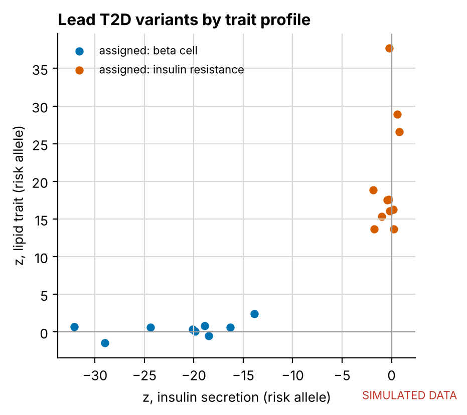
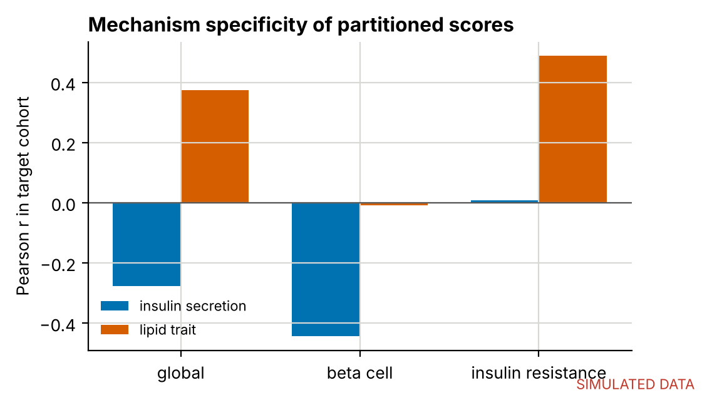
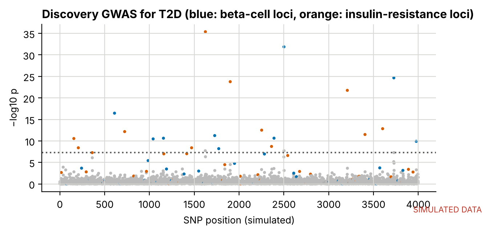

# Mechanism-partitioned polygenic scores for type 2 diabetes: a simulation study

Type 2 diabetes is heterogeneous. Some risk alleles act mainly through **pancreatic beta-cell dysfunction**, and others through **insulin resistance**, adiposity and atherogenic dyslipidaemia. A single global polygenic score (PRS) mixes these mechanisms together. Scores built from variant clusters that each reflect one process can stratify patients by *why* they are at risk, not only *how much*.

This repository works through that idea end to end in a setting where the truth is known.

1. **Simulate** genotypes with LD, two causal mechanisms, two intermediate traits (insulin secretion and an AIP-like lipid trait), and a T2D outcome. There is a discovery cohort (n = 20,000) and an independent target cohort (n = 5,000).
2. **Run GWAS** in the discovery cohort for T2D and both intermediate traits.
3. **Build a global PRS** by clumping and thresholding (C+T). The p-value threshold is tuned on one half of the target cohort and evaluated on the other half.
4. **Partition the lead variants.** Each variant's association profile across the intermediate traits, oriented to its T2D risk allele, is clustered by non-negative matrix factorisation with positive and negative channels split, a simplified version of the bNMF approach.
5. **Test specificity.** The beta-cell score should track insulin secretion but not the lipid trait, and the insulin-resistance score should do the reverse.

## Result (simulated data)

| Score | SNPs | T2D AUC | r with insulin secretion | r with lipid trait |
|---|---|---|---|---|
| Global | 20 | 0.72 | −0.28 | 0.37 |
| Beta-cell | 9 | 0.65 | **−0.44** | −0.01 |
| Insulin resistance | 11 | 0.66 | 0.01 | **0.49** |

Clustering recovered the true mechanism for all 20 lead variants. The global score predicts T2D best, but it cannot tell the two routes to disease apart. The partitioned scores trade some discrimination for **mechanistic specificity**, and specificity is what clinical stratification needs.

| Variant clusters | Specificity |
|---|---|
|  |  |



## Why this matters to me

My MSc work compares HbA1c with glycated albumin in people living with HIV ([hba1c-ga-method-agreement](https://github.com/watsonmash/hba1c-ga-method-agreement)). HbA1c is affected by non-glycaemic, erythrocyte-related determinants, including genetic variants such as the G6PD variant that is common in people of African ancestry. A score is only clinically useful if we understand the mechanism it indexes. The same logic applies to polygenic scores, and it is why I want to work on mechanism-specific PRS.

## Run it

```bash
pip install -r requirements.txt
python src/run_demo.py      # ~15 s; tables -> outputs/prs_results.xlsx, figures -> outputs/
```

## Limitations of the simulation

- LD follows a simple AR(1) block structure, and allele frequencies are uniform. Real LD and ancestry structure are far richer.
- Each causal variant acts through exactly one mechanism. Real T2D loci are often pleiotropic, which is why soft clustering (bNMF) is used in practice.
- The GWAS is a linear model on standardised genotypes. Real analyses use logistic or mixed models with covariates and principal components.

## Next step: real data

See [`real_data/README.md`](real_data/README.md) for the workflow on public data: T2D summary statistics, a 1000 Genomes reference panel, PLINK 2, and PRSice-2 or PGS Catalog scoring files.

Author: Watson Mashandudze · Licence: MIT
